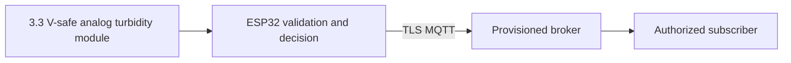

# SmartWaterQualityMonitoringSystem

## Overview
Water quality trend monitor is a standalone ESP32 demonstration for water science learners. It measures turbidity sensor signal (ADC counts) and pH module signal (ADC counts) with 3.3 V-safe analog turbidity module; 3.3 V-safe analog pH interface. **Safety:** Raw sensor trends are not NTU, calibrated pH, or proof of potability; lab analysis is required.

## Problem statement and objectives
Manual checks can miss changes in turbidity sensor signal. The objective is to sample the attached hardware every five seconds, validate readings, publish them securely, and flag the project-specific condition `turbidity sensor signal > 2600.0f || pH module signal < 900.0f || pH module signal > 3200.0f`. It is an educational prototype, not a certified control or safety product.

## Key features and target users
- Project-specific acquisition and threshold logic for water science learners.
- Wi-Fi connection and MQTT over TLS with a broker CA certificate and per-device credentials.
- Bounded reconnect backoff, invalid-sample reporting, and no physical output.
- A native simulation test for the threshold and invalid-reading rule.

## System architecture and data flow

The sensor feeds the ESP32. A validated sample produces an alert flag and a JSON telemetry message under the device's topic. The broker and any subscriber are operator supplied; this repository contains firmware only.

## Hardware components and wiring overview
Use an ESP32 DevKit, 3.3 V-safe analog turbidity module; 3.3 V-safe analog pH interface. See [HARDWARE.md](docs/HARDWARE.md) for the pin table, voltage limits, and calibration notes. No actuator is implemented; alerts are telemetry flags only.

## Software technologies
PlatformIO, Arduino ESP32, C++, PubSubClient 2.8, and native C++ simulation tests. No backend, database, or frontend is included because this device publishes to an existing broker. There is no bundled dashboard; an authorized MQTT client can consume telemetry.

## Requirements
Functional: sample turbidity sensor signal, reject values outside 0–4095 ADC counts, flag `turbidity sensor signal > 2600.0f || pH module signal < 900.0f || pH module signal > 3200.0f`, and publish a telemetry record. Non-functional: use a broker-verified TLS connection, unique device credentials, bounded messages, and safe output behavior during a disconnect. Physical measurement accuracy depends on calibration.

## Directory structure
`src/main.cpp` reads the sensor and publishes telemetry; `include/logic.h` contains validation and decision rules; `include/device_config.example.h` is a non-secret template; `test/logic.cpp` simulates edge cases; `docs/` holds implementation-specific guidance.

## Installation, configuration, and device provisioning
Follow [INSTALLATION.md](docs/INSTALLATION.md). Copy the example device configuration to ignored `include/device_config.h`, set Wi-Fi and broker values, paste the broker's CA certificate, and issue a unique MQTT username/password with publish-only ACL for `devices/<device-id>/telemetry`. Build with `python -m platformio run`; flash only after checking the wiring.

## How it works, API, and MQTT communication
Every five seconds firmware reads turbidity sensor signal, validates it, computes the alert flag, and publishes the JSON schema in [API.md](docs/API.md). No REST API or inbound command topic is implemented. No measurements are persisted by this repository; see [DATABASE.md](docs/DATABASE.md).

## Security, testing, and troubleshooting
See [SECURITY.md](SECURITY.md), [TESTING.md](docs/TESTING.md), and [TROUBLESHOOTING.md](docs/TROUBLESHOOTING.md). The software build and simulation can run without hardware. Physical sensor accuracy, electrical installation, and end-to-end broker connectivity require user validation.

## Limitations and future improvements
Raw sensor trends are not NTU, calibrated pH, or proof of potability; lab analysis is required. See [ROADMAP.md](docs/ROADMAP.md) for calibration and field-test work.

## References and license
- [ESP32 Arduino documentation](https://docs.espressif.com/projects/arduino-esp32/en/latest/)
- [PlatformIO ESP32 platform documentation](https://docs.platformio.org/en/latest/platforms/espressif32.html)
- [PubSubClient library](https://github.com/knolleary/pubsubclient)
- [MIT license](LICENSE)
