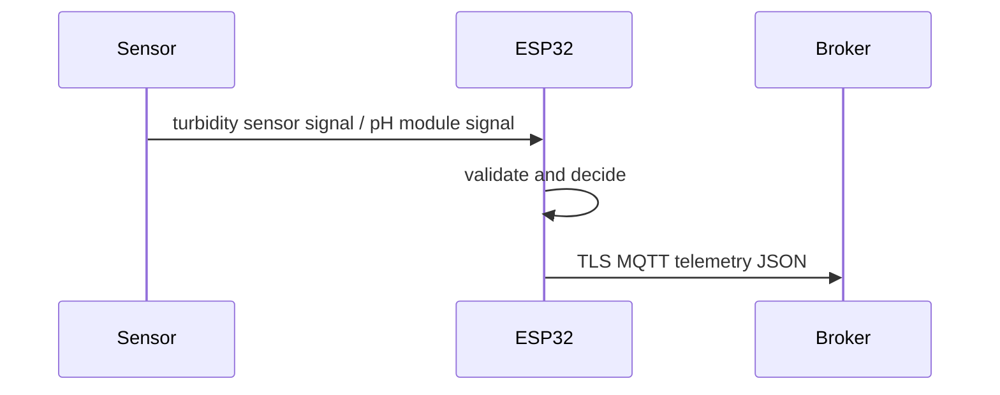

# Architecture — SmartWaterQualityMonitoringSystem

The dual_analog acquisition path yields a `Sample` of turbidity sensor signal and pH module signal. `logic.h` validates the primary value against 0–4095 ADC counts and evaluates `s.value > 2600.0f || s.aux < 900.0f || s.aux > 3200.0f` only for valid samples. No actuator is implemented; alerts are telemetry flags only.

Wi-Fi and broker reconnection use a backoff from one to sixty seconds. The firmware has no inbound command handler. MQTT broker provisioning, persistence, alert delivery, and visualization are outside the codebase. SNTP supplies wall time before TLS certificate validation.
